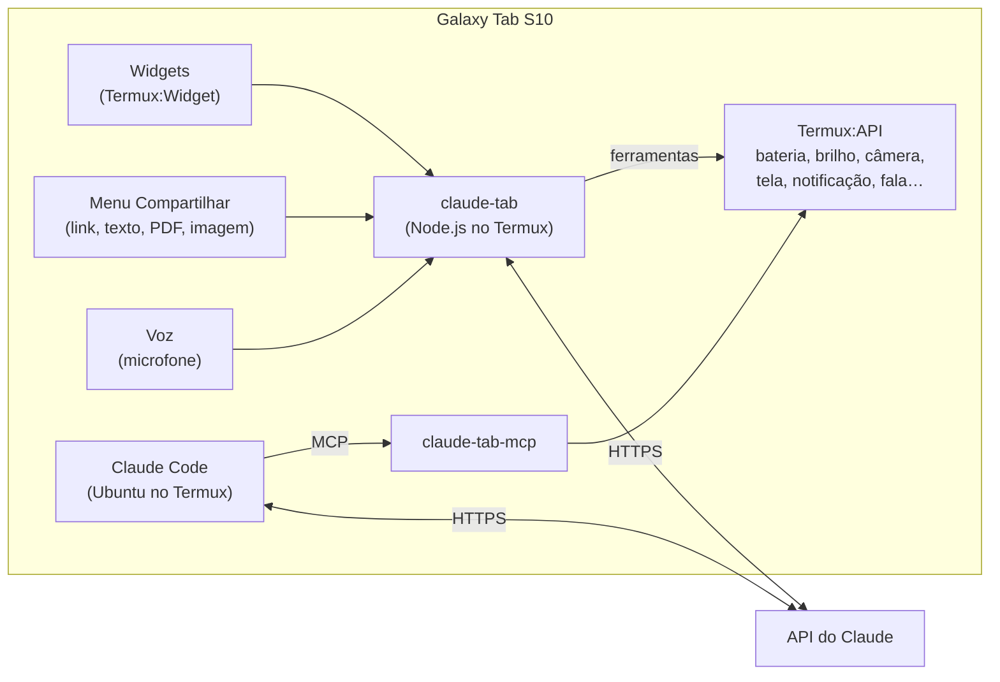

# Integrando o Claude ao seu Galaxy Tab S10

O guia vai do mais simples (5 minutos, sem instalar nada técnico) ao avançado (o Claude controlando o tablet por voz e o Claude Code com acesso às funções do aparelho). Faça os níveis em ordem e pare onde já atender ao que você precisa.

| Nível | O que você ganha | Tempo | Precisa de |
|---|---|---|---|
| **1. App oficial** | Chat, voz, câmera, widget, agenda e alarmes | 5 min | Conta Claude |
| **2. Atalhos Samsung** | Claude na tecla lateral, na S Pen, no Painel Edge e em par com o Samsung Notes | 10 min | Nível 1 |
| **3. claude-tab (este repositório)** | Assistente por voz que **age no tablet**, menu "Compartilhar", atalhos que analisam a tela ou o texto copiado, respostas em notificação | 30 min | Termux + chave da API |
| **4. Claude Code + MCP** | Claude Code rodando no tablet com acesso às funções do aparelho | 30–60 min | Nível 3 + Ubuntu no Termux |

> **Estudando?** O [modo estudo](#modo-estudo-chamar-o-claude-sem-parar-de-estudar) mostra como chamar o Claude por voz ("Claude, …") ou por escrita (S Pen) sem sair do Samsung Notes.

---

## Nível 1: App oficial do Claude

1. **Play Store › "Claude by Anthropic"** › Instalar › entre com a sua conta.
2. **Widget na tela inicial:** toque e segure na tela inicial › **Widgets** › **Claude** › arraste. O widget tem três botões: **novo chat**, **câmera** (fotografa e já pergunta) e **microfone** (ditado).
3. **Modo de voz:** no chat, toque no ícone de voz para conversar falando.
4. **Integrações do Android** (permissões pedidas na hora do uso):
   - **Agenda:** o Claude consulta sua disponibilidade e cria eventos.
   - **Alarmes e timers:** pelo app Relógio.
   - **Mensagens e e-mail:** o Claude **redige** e você envia no app (WhatsApp, Gmail…). Ele não lê suas mensagens.
   - **Localização e mapas:** sugestões por perto e rota no Google Maps.
   - Gerencie as permissões em *Configurações › Apps › Claude › Permissões*.
5. **Compartilhar com o Claude:** em qualquer app (Galeria, Chrome, Meus Arquivos), toque em **Compartilhar › Claude** para mandar foto, PDF ou texto para um chat.

> Lembretes do sistema só existem no Claude para iOS. No Android, use alarmes ou a agenda.

---

## Nível 2: Atalhos Samsung (One UI)

| Onde | Como configurar | Resultado |
|---|---|---|
| **Tecla lateral** | *Configurações › Recursos avançados › Tecla lateral › Pressionar duas vezes › Abrir app › Claude* | Dois toques na tecla lateral abrem o Claude |
| **S Pen** | *Configurações › Recursos avançados › S Pen › Comando aéreo › Atalhos › +* › Claude | Claude no menu da caneta |
| **Painel Edge** | *Configurações › Tela › Painéis Edge › Apps* › adicionar Claude | Claude a um deslize da borda |
| **Par de apps** | Abra Claude e Samsung Notes em tela dividida › menu `⋯` do divisor › **Adicionar par de apps** | Os dois abrem juntos, lado a lado |
| **Barra de tarefas** | Arraste o Claude para a barra | Sempre à mão, inclusive no DeX |
| **Modos e Rotinas** | *Configurações › Modos e Rotinas › Rotinas › +* › Se: horário ou dispositivo Bluetooth conectado › Então: **Abrir app › Claude** | Ex.: abrir o Claude ao conectar o teclado Bluetooth |
| **Assistente padrão** | *Configurações › Apps › Escolher apps padrão › App de assistente digital* | Se o Claude aparecer na lista, segurar a tecla lateral passa a abri-lo. A Anthropic **não documenta** esse suporte; se não aparecer, use o "Pressionar duas vezes" acima |

**Fluxos que funcionam bem com a S Pen:**

- **Seleção inteligente › Compartilhar › Claude:** recorte um trecho da tela (gráfico, exercício, código) e pergunte direto.
- **Escrita na tela › Compartilhar › Claude:** circule à mão o que quer explicado e mande a captura.
- **Samsung Notes:** exporte a nota como PDF e use **Compartilhar › Claude** para revisar, resumir ou gerar exercícios.

> A tecla **Galaxy AI** dos teclados Book Cover abre Gemini ou Bixby. A Samsung diz que só "apps selecionados" podem ser atribuídos a ela, então provavelmente não aceita o Claude.

---

## Nível 3: claude-tab, o Claude agindo no tablet

Este repositório traz o **claude-tab**, que roda no **Termux** (terminal Linux para Android) e usa o **Termux:API** para acessar recursos do tablet.

### O que ele faz



| Atalho / comando | O que acontece |
|---|---|
| **Claude Voz** (widget) · `claude-tab voz` | Conversa por voz. Você fala, o Claude responde em voz alta e **age no tablet** ("abaixa o brilho", "qual a bateria?", "anota isso", "liga a lanterna"). Diga "tchau" para sair |
| **Claude Tela** (widget) · `claude-tab tela` | Analisa a **última captura de tela**: explica um erro, resolve um exercício, resume um gráfico. A resposta chega como notificação |
| **Claude Copiado** (widget) · `claude-tab area` | Pega o texto copiado e oferece um menu: Resumir, Responder ao que escrevi, Explicar, Traduzir, Extrair tarefas, Revisar, Salvar como nota, Perguntar… |
| **Claude Pergunta** (widget) | Abre uma caixa de texto e responde em notificação |
| **Claude Estudo** / **Claude Estudo Voz** (widgets) · `claude-tab estudo [--escutar]` | Modo estudo: notificação fixa com Escrever, Falar e Encerrar. Com escuta, responde quando você diz "Claude, …" (veja abaixo) |
| **Compartilhar › Termux** (em qualquer app) | Mesmo menu de ações para **links** (o Claude lê a página), **textos**, **PDFs** e **imagens** |
| `claude-tab perguntar "…" -a arquivo.pdf` | Uso no terminal, com anexos e `--falar`, `--notificar`, `--copiar` |

**As respostas em notificação** têm os botões **Copiar** e **Compartilhar**. Este último manda o texto direto para o Samsung Notes, o WhatsApp etc.

**Ferramentas que o Claude pode usar no tablet:**

| Livre | Pede sua confirmação (diálogo ou digital) |
|---|---|
| info do tablet, bateria, Wi-Fi, sensores, volume, brilho, lanterna, notificação, aviso na tela, falar, abrir link, copiar texto, compartilhar texto, salvar nota (em *Documentos/Claude*), perguntar ao usuário | ler a área de transferência, ver a última captura de tela, tirar foto, localização, ler notificações |

Também há **busca e leitura na web** (executadas nos servidores da Anthropic) para perguntas sobre fatos atuais e links compartilhados.

### Instalação passo a passo

**1. Instale os apps, todos da MESMA fonte.** Recomendado: [F-Droid](https://f-droid.org). Termux, Termux:API e Termux:Widget precisam ter a mesma assinatura.

- **Termux**, **Termux:API** e **Termux:Widget**
- Se o **Bloqueador automático** da Samsung impedir a instalação: *Configurações › Segurança e privacidade › Bloqueador automático*. Desative durante a instalação e reative depois.

**2. Permissões do Termux:API** (*Configurações › Apps › Termux:API › Permissões*): **Microfone**, **Câmera** e **Localização**. Para ajustar o brilho, conceda também *Modificar configurações do sistema*. Para ler notificações, conceda *Acesso a notificações*.

**3. Obtenha uma chave da API** em [console.anthropic.com](https://console.anthropic.com) › *API Keys*.
> A assinatura do Claude (Pro/Max) **não inclui** créditos da API. O uso da API é cobrado à parte, por consumo (veja **Custos** abaixo).

**4. No Termux, rode:**

```bash
pkg install -y git
git clone https://github.com/arthurpsdm-droid/omniroute ~/claude-tab
bash ~/claude-tab/termux/instalar.sh
```

O instalador:

- instala Node.js, Termux:API, ImageMagick e git;
- pede acesso ao armazenamento;
- cria os comandos `claude-tab` e `claude-tab-mcp`;
- copia os atalhos para o Termux:Widget e configura o menu Compartilhar;
- pede a chave da API e a guarda em `~/.config/claude-tab/env`, com permissão só para você.

**5. Widget na tela inicial:** toque e segure › **Widgets › Termux:Widget** › arraste. Aparecem *Claude Voz*, *Claude Tela*, *Claude Copiado*, *Claude Pergunta*, *Claude Estudo*, *Claude Estudo Voz* e *Claude Code*.

**6. Teste:**

```bash
claude-tab diagnostico
claude-tab perguntar "Oi! Como está a bateria do tablet?"
claude-tab voz
```

### Configuração (`~/.config/claude-tab/env`)

| Variável | Padrão | Para quê |
|---|---|---|
| `ANTHROPIC_API_KEY` | (obrigatória) | Sua chave da API |
| `CLAUDE_TAB_MODELO` | `claude-opus-5-5` | Modelo usado. `claude-haiku-5-5` é bem mais barato e mais rápido, com respostas menos elaboradas |
| `CLAUDE_TAB_ESFORCO` | `medium` | Profundidade de raciocínio: `low`, `medium`, `high`, `xhigh`, `max` |
| `CLAUDE_TAB_ESFORCO_VOZ` | `low` | Mesmo ajuste para o modo voz (baixo = resposta mais rápida) |
| `CLAUDE_TAB_IDIOMA` | `pt-BR` | Idioma da voz (TTS) |
| `CLAUDE_TAB_CONFIRMAR` | `dialogo` | Confirmação de ações sensíveis: `dialogo` (Sim/Não), `digital` (impressão digital) ou `nenhum` |
| `CLAUDE_TAB_ESFORCO_ESTUDO` | `low` | Profundidade de raciocínio no modo estudo (`medium` dá respostas mais elaboradas, um pouco mais lentas) |
| `CLAUDE_TAB_PALAVRAS_ATIVACAO` | `claude,claud,clode,cloud,claudio` | Palavras que acordam o Claude no modo estudo com escuta |
| `CLAUDE_TAB_WEB` | `1` | `0` desliga a busca e a leitura de páginas web |
| `CLAUDE_TAB_FALLBACK` | `1` | Se um filtro de segurança recusar o pedido, o servidor tenta de novo no modelo recomendado. `0` desliga |
| `CLAUDE_TAB_PASTA_NOTAS` | `Documentos/Claude` | Onde as notas são salvas |

### Custos (estimativa)

O preço do `claude-opus-5-5` é **US$ 4 por milhão de tokens de entrada e US$ 20 por milhão de saída** (tabela de outubro de 2026). Uma pergunta típica do claude-tab envia cerca de 4–6 mil tokens (instruções + descrição das ferramentas) e recebe algumas centenas. Isso dá **centavos de dólar por pergunta**, menos quando o cache de prompt é aproveitado em conversas seguidas. Imagens e PDFs aumentam o consumo, e as buscas na web são cobradas à parte. Acompanhe o gasto em *console.anthropic.com › Usage* e defina um limite mensal lá.

### Privacidade e segurança

- O que você envia (texto, capturas, fotos, PDFs) vai para a API da Anthropic para gerar a resposta.
- Ações sensíveis **sempre pedem confirmação**, a menos que você mude `CLAUDE_TAB_CONFIRMAR`. Com `digital`, a confirmação usa o leitor de impressão digital do tablet.
- O Claude **não envia mensagens** por você: em "compartilhar", quem escolhe o app e aperta enviar é você.
- `abrir_link` só aceita `https://`, `http://`, `geo:` e `mailto:`.
- A chave fica em `~/.config/claude-tab/env` (permissão 600), dentro da área privada do Termux.

---

## Modo estudo: chamar o Claude sem parar de estudar

Há três jeitos de chamar o Claude enquanto você estuda, do mais simples ao mais completo.

### Jeito 1: só com o app oficial (níveis 1 e 2)

- **Por voz:** se a ativação por voz da Bixby ("Oi Bixby", em *Configurações › Recursos avançados › Bixby*; o nome do menu pode variar) ou o "Ok Google" do Gemini estiver ligado, diga **"abrir Claude"** e toque no ícone de voz do app. Abra o Claude em **visualização pop-up** (janela flutuante) por cima do Samsung Notes para não perder a página.
- **Por escrita:** tire a S Pen › **Comando aéreo › Claude** e escreva a pergunta à mão no campo de texto. O recurso S Pen para texto converte a letra.
- **Pergunta escrita no caderno:** escreva a dúvida à mão no Samsung Notes, recorte com a **Seleção inteligente** e toque em **Compartilhar › Claude**.

Limite: o app oficial não fica esperando a palavra "Claude". Você abre o app a cada pergunta.

### Jeito 2: modo estudo do claude-tab, com botões

Toque no atalho **Claude Estudo** (ou rode `claude-tab estudo`) e volte para o que estava estudando. Aparece uma **notificação fixa** que você alcança de qualquer app, puxando a barra de notificações:

| Botão | O que faz |
|---|---|
| **Escrever** | Abre uma caixa de texto por cima do app atual. Escreva com a S Pen (vira texto) ou com o teclado. A resposta chega numa notificação |
| **Falar** | Ouve uma pergunta e responde em voz alta e numa notificação |
| **Encerrar** | Fecha o modo estudo e salva a sessão |

O Claude lembra das perguntas anteriores da mesma sessão. Dá para pedir "explica de novo de um jeito mais simples".

### Jeito 3: modo estudo com escuta ("Claude, …")

Toque em **Claude Estudo Voz** (ou rode `claude-tab estudo --escutar`). O tablet fica ouvindo, e o Claude só responde quando a frase **começa com "Claude"**:

- "Claude, o que é osmose?"
- "Claude, explica de novo de um jeito mais simples."
- "Claude, olha minha tela e me ajuda com esse exercício." (Tire uma captura de tela antes. Ele pede autorização para ver.)
- "Claude, encerrar."

Os botões da notificação continuam funcionando ao mesmo tempo.

**O que é enviado ao Claude:**
1. O reconhecimento de voz do Android transforma o que ouve em texto. Ele usa o serviço de voz do Google ou da Samsung, conforme a sua configuração.
2. O claude-tab confere, no próprio tablet, se o texto começa com "Claude".
3. Se não começar, o texto é descartado. Ele aparece só na janela do Termux, marcado como "ignorado".
4. Só as frases que começam com "Claude" vão para a API.

**Dicas:**
- **Microfone:** deixe o Termux numa **janela pop-up pequena** ou em tela dividida ao lado do Samsung Notes. Se o Android pausar o microfone quando o Termux sai da tela, isso resolve.
- **Bateria:** o ícone de microfone fica aceso enquanto o tablet escuta, e a escuta contínua gasta mais bateria. Para economizar, use o Jeito 2.
- **Ele não entende "Claude":** veja na janela do Termux como a palavra apareceu em "ignorado" e acrescente essa grafia em `CLAUDE_TAB_PALAVRAS_ATIVACAO`.
- **Respostas mais elaboradas:** use `CLAUDE_TAB_ESFORCO_ESTUDO=medium`. Elas demoram um pouco mais.

**Registro da sessão:** cada pergunta e resposta é gravada em `Documentos/Claude/estudo-AAAA-MM-DD_HHMM.md`. Abra pelo Meus Arquivos para revisar depois.

### Pergunta escrita à mão, com o claude-tab

Escreva a dúvida no Samsung Notes › **Seleção inteligente** › **Compartilhar › Termux** › **Responder ao que escrevi**. O Claude lê a sua letra e responde numa notificação. Se for um exercício, ele explica a resolução passo a passo.

---

## Nível 4: Claude Code no tablet com acesso ao aparelho

O **Claude Code** é o agente de programação e automação da Anthropic. No Tab S10 com teclado (ou no DeX com monitor) ele vira uma estação de trabalho completa. Com o servidor MCP do claude-tab, ele também passa a enxergar e controlar o tablet.

### Opção A: sem instalar nada (nuvem)

Abra **claude.ai/code** no navegador (ou a aba *Code* do app Claude). As sessões rodam na nuvem, ligadas aos seus repositórios do GitHub. É o caminho mais simples e não depende do Termux, mas nesse modo **o Claude Code não acessa o hardware do tablet**.

### Opção B: Claude Code rodando no tablet (Ubuntu dentro do Termux)

A Anthropic não publica um binário do Claude Code para o Android/Termux. O caminho mais confiável é um Ubuntu via `proot-distro`, onde funciona o **instalador oficial**:

```bash
# no Termux
pkg install -y proot-distro
proot-distro install ubuntu
proot-distro login ubuntu

# dentro do Ubuntu
apt update && apt install -y curl git
curl -fsSL https://claude.ai/install.sh | bash
claude          # faça login com sua conta Claude (Pro/Max) ou chave da API
```

> Existem pacotes da comunidade que rodam o Claude Code direto no Termux, sem Ubuntu. Eles **não são oficiais**: leia o código antes de usar. O proot adiciona alguma lentidão em operações com muitos arquivos (ex.: `npm install` grande).

**Conecte as ferramentas do tablet (MCP).** Ainda dentro do Ubuntu:

```bash
claude mcp add -s user tablet -- \
  /data/data/com.termux/files/usr/bin/node \
  /data/data/com.termux/files/home/claude-tab/bin/claude-tab-mcp.mjs
claude mcp list     # deve mostrar "tablet" conectado
```

O servidor usa o Node do Termux e encontra sozinho os comandos `termux-*`, mesmo de dentro do Ubuntu (não use `proot-distro login --isolated`). O próprio Claude Code pede sua permissão antes de cada ferramenta, então o servidor MCP vem com a confirmação na tela desligada. Para ligá-la também ali, use `CLAUDE_TAB_CONFIRMAR_MCP=dialogo`.

**Exemplos de pedidos ao Claude Code:**

- "Veja minha última captura de tela e transforme a tabela dela num CSV em `~/dados.csv`."
- "Leia `relatorio.pdf`, salve um resumo como nota e me avise com uma notificação quando terminar."
- "Se a bateria estiver abaixo de 20 %, baixe o brilho para 30 % e me avise."
- "Tire uma foto do quadro com a câmera traseira e passe o conteúdo para Markdown."

O atalho **Claude Code** do Termux:Widget abre direto o Ubuntu com o `claude`.

---

## Solução de problemas

| Sintoma | Causa provável | Solução |
|---|---|---|
| `comando "termux-…" não foi encontrado` | Falta o pacote | `pkg install termux-api` |
| Comando trava e dá "não respondeu em N s" | Falta o app Termux:API, ele veio de outra loja ou está sem permissão | Instale o Termux:API da mesma fonte do Termux e conceda as permissões |
| "Chave da API inválida" | Chave ausente ou errada | `claude-tab configurar` |
| Brilho não muda | Falta a permissão de sistema | *Apps › Termux:API › Modificar configurações do sistema* |
| "Não encontrei capturas de tela" | Sem acesso ao armazenamento | `termux-setup-storage` |
| Imagem grande dá erro | ImageMagick ausente | `pkg install imagemagick` |
| Widget não aparece | Falta o Termux:Widget ou os scripts não estão em `~/.shortcuts` | Reinstale o Termux:Widget e rode o instalador de novo |
| Modo estudo não reage a "Claude" | O reconhecedor escreveu a palavra de outro jeito | Veja a grafia em "ignorado" no Termux e acrescente em `CLAUDE_TAB_PALAVRAS_ATIVACAO` |
| Escuta para quando saio do Termux | O Android pausa o microfone de apps fora da tela | Deixe o Termux em janela pop-up ou tela dividida |
| Botão da notificação diz "modo estudo não está ativo" | A sessão foi fechada (ou o Termux encerrado) | Abra o atalho Claude Estudo de novo |
| Voz não entende | Reconhecimento de voz do sistema em outro idioma | *Configurações › Gerenciamento geral › Idioma* e serviço de voz em Português |
| Erro sobre `fallbacks` | A conta ou plataforma não aceita o recurso | `CLAUDE_TAB_FALLBACK=0` no arquivo `env` |
| Erro sobre `web_search` | Busca web desativada na organização da API | `CLAUDE_TAB_WEB=0` ou habilite no console |

---

## Fontes

- Anthropic: [Usar o Claude com apps do Android](https://support.claude.com/en/articles/11869629-using-claude-with-android-apps) · [Widget do Claude no Android](https://support.claude.com/en/articles/10534883-using-the-claude-widget-on-android)
- Claude Code no Termux: [Claude Code in Termux on Android: What Works in 2026](https://jonathansblog.co.uk/?p=30143) · [Pedido de binário oficial para Android](https://claudeissues.com/issue/72620-feature-publish-linux-arm64-android-native-binary-for-termux)
- Comandos do Termux dentro do proot: [blogbyben.com](https://www.blogbyben.com/2023/02/termuxapi-commands-from-prooted-ubuntu.html)
- Assistente padrão no Android: [Make Tech Easier](https://maketecheasier.com/change-default-digital-assistant-android) · [ChatGPT na tecla lateral (precedente)](https://www.sammobile.com/news/summon-chatgpt-side-button-galaxy-phones/)
- Tecla Galaxy AI: [Samsung, Book Cover Keyboard (AI Key)](https://www.samsung.com/us/mobile-accessories/galaxy-tab-s10-fe-plus-book-cover-keyboard-ai-key-black-ef-dx625ubeguj/)
